# MiniFlows 自研深度学习框架 —— 实验报告

> 课程：进阶式挑战性综合项目 I
> 作者：Rinck1
> 仓库：https://github.com/Rinck1/CNN-AutoDrive
> 复现方式：项目根目录执行 `python applications/mnist.py` 等脚本（见 README）

---

## 摘要

本项目用纯 numpy 从零实现了一个迷你深度学习框架 **MiniFlows**，具备计算图、自动求导、
卷积/池化、三种激活函数、MBGD 与 Adam 优化器、训练器等完整要素；并在其上完成
线性回归、逻辑回归、鸢尾花分类、MNIST 手写数字识别与 DonkeyCar 自动驾驶（模拟赛道）
五类应用，另用 PyTorch 搭建同结构 LeNet-5 作对照。五项可选扩展全部完成：
计算图可视化、梯度数值检验、异常训练分析、数据预处理模块、框架优化功能。

核心结果：17 项算子梯度检验全部通过（最大相对误差 1.36e-7；框架单测 34 项最大 2.98e-9）；MNIST 测试准确率
**92.85%**，与 PyTorch 的 93.05% 仅差 0.20 个百分点；DonkeyCar 严格评测转向角 MAE 0.0534±0.0069。

---

## 一、任务完成情况

| 课程任务 | 完成情况 | 关键结果 |
|---|---|---|
| 1) 用框架搭建经典 CNN | PyTorch LeNet-5 | 3 轮 8000 样本，测试 93.05% |
| 2) 自研深度学习框架 | MiniFlows（10 个模块） | 计算图 + 自动求导 + conv/pool + MBGD/Adam |
| 2) 线性回归 / 逻辑回归 | 均已实现 | w=2.99、b=2.04；二分类 100% |
| 3) 鸢尾花 / MNIST | 均已实现 | MLP 93.33%；自研 CNN 92.85% |
| 4) DonkeyCar 自动驾驶 | 合成赛道 + 闭环仿真 + 严格评测 | 严格测试 MAE 0.0534±0.0069；同分布闭环 100%，极端 0% |
| 5) 需求/可行性/设计/报告 | 四份文档 | `docs/` 与本报告 |
| ① 计算图可视化 | 纯 matplotlib 分层 DAG | 表达式图 6 节点、MLP 图 11 节点 |
| ② 自动求导 + 梯度检验 | 中心差分对照 | 17 项全通过，最大误差 1.36e-7 |
| ③ 异常训练分析 | 四类现象对照实验 | 过拟合/消失/爆炸/学习率震荡 |
| ④ 数据预处理 | 6 类预处理与增强 | 标准化、one-hot、分层、MNIST、平移 |
| ⑤ 框架优化功能 | 7 项增强 | 动量/Dropout/L2/早停/调度/持久化 |

---

## 二、框架设计要点

1. **计算图**：无全局图对象，`Node` 通过 `parents` 引用构成 DAG；每个非叶子节点
   持有 `_backward` 闭包，反向时按拓扑排序逆序执行，梯度用 `+=` 累加。
2. **广播处理**：`unbroadcast()` 沿被扩张的轴求和，保证偏置/广播运算的梯度形状正确。
3. **卷积**：im2col 把感受野展平成矩阵，一次 BLAS 乘法完成前向；col2im 散射梯度。
4. **数值稳定**：Softmax/CE 减最大值；BCE 用 `max(z,0)-z·t+log(1+e^{-|z|})`。
5. **易用性**：`Sequential([...])` + `Trainer(...).train(X, y)`，与 Keras 类似。

详细算法推导见 `docs/详细设计.md`。

---

## 三、扩展项实验结果

### 3.1 扩展① 计算图可视化

表达式 `z=(a+b)*(b+c)` 的计算图（左图为参数/常量/运算/损失四类配色）：

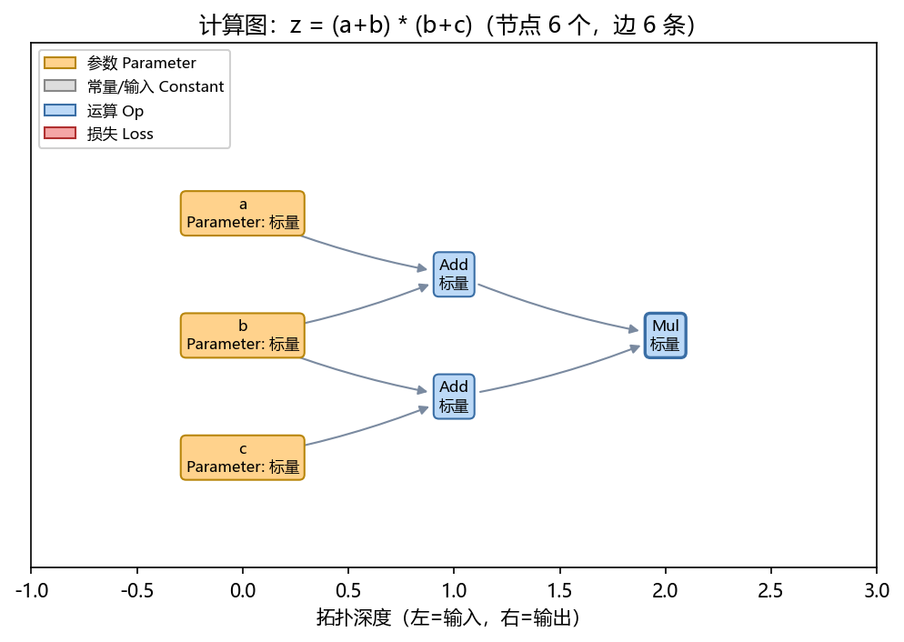

MLP(4-16-3)+CrossEntropyLoss 的完整前向图（11 节点、10 条边）：

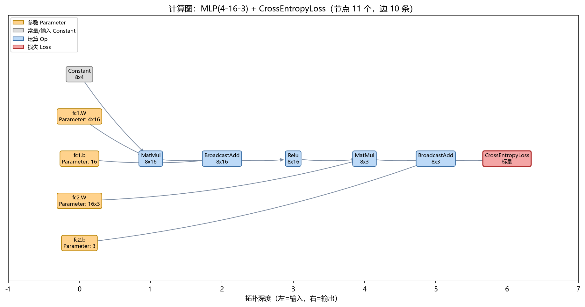

手算验证：`dz/da=4, dz/db=9, dz/dc=5`，与框架自动求导结果完全一致。

### 3.2 扩展② 梯度检验

对 16 个算子 + 1 个 MLP 做中心差分（ε=1e-5）检验，判据为逐元素相对误差：

| 序号 | 算子/模型 | 最大相对误差 | 结果 |
|---|---|---|---|
| 1 | add | 3.435e-11 | ✓ |
| 2 | matmul | 1.102e-10 | ✓ |
| 3 | broadcast_add | 2.823e-10 | ✓ |
| 4 | mul | 9.363e-11 | ✓ |
| 5 | relu | 4.420e-11 | ✓ |
| 6 | sigmoid | 3.518e-10 | ✓ |
| 7 | tanh | 1.361e-07 | ✓ |
| 8 | softmax | 1.567e-10 | ✓ |
| 9 | MSELoss | 1.459e-10 | ✓ |
| 10 | BCEWithLogitsLoss | 1.969e-10 | ✓ |
| 11 | CrossEntropyLoss | 1.187e-09 | ✓ |
| 12 | conv2d | 1.920e-09 | ✓ |
| 13 | maxpool2d | 5.518e-10 | ✓ |
| 14 | avgpool2d | 2.548e-11 | ✓ |
| 15 | transpose | 8.029e-09 | ✓ |
| 16 | sum(axis=1) | 3.597e-11 | ✓ |
| 17 | MLP+CE | 1.904e-09 | ✓ |

全部通过（阈值 1e-5），说明反向传播的链式法则、广播还原、卷积 col2im、
softmax 雅可比均实现正确。完整报告见 `outputs/exp2/梯度检验报告.md`。

### 3.3 扩展③ 异常训练分析

**(a) 过拟合**（60 训练样本 + MLP 4-128-128-3）：

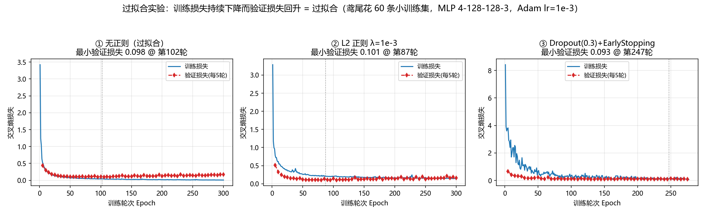

无正则时训练损失降到 0.0077，验证损失最小 0.0981、终值 0.1677；
L2(1e-3) 与 Dropout+早停把验证损失降到 0.1563 / 0.1004，说明正则有效。

**(b) 梯度消失**（8 层 Linear(32,32)，初始化时的逐层梯度范数）：

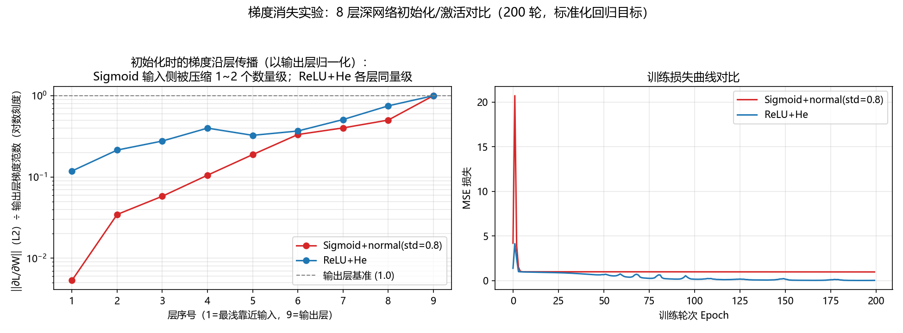

以输出层梯度归一化后，Sigmoid+normal 的输入侧梯度仅为输出层的 **0.5%**，
ReLU+He 为 **11.8%**（相差约 24 倍）；训练损失最终 0.9821 vs 0.0369。
Sigmoid 导数上界 0.25 + 饱和，使梯度逐层相乘后指数衰减。

**(c) 梯度爆炸与裁剪**（init_std=0.3，lr=0.1，8 层 ReLU）：

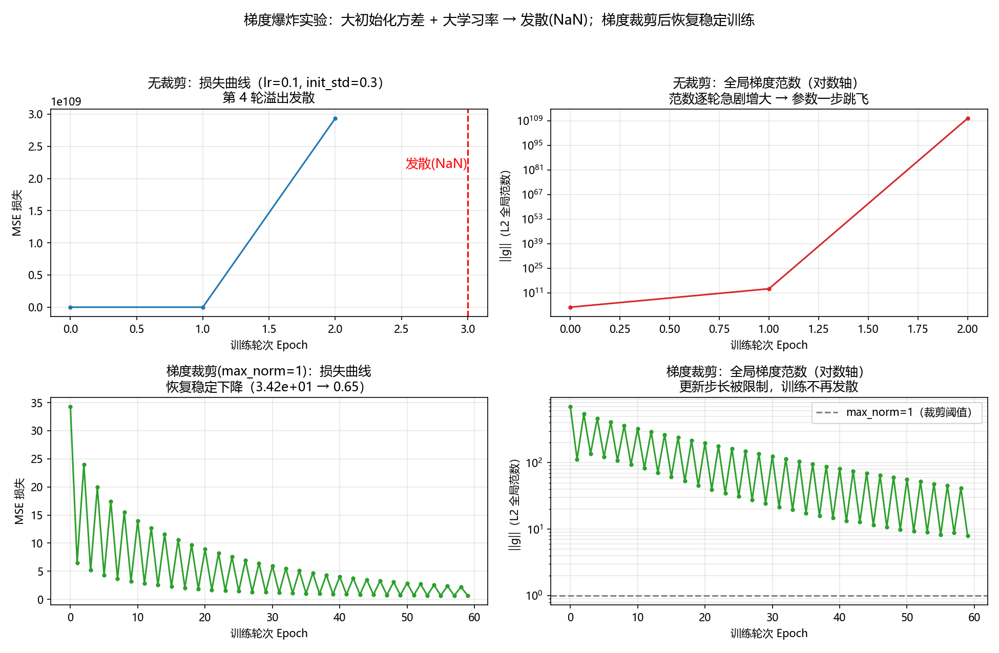

无裁剪时第 4 轮出现 NaN/Inf；开启全局范数裁剪（max_norm=1）后损失从
3.4e1 稳定降到 **0.648**，证明裁剪放在 `backward` 与 `step` 之间可恢复数值稳定。

**(d) 学习率震荡**（线性回归）：

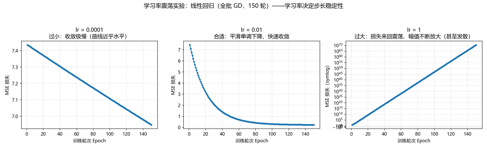

lr=1e-4 时 150 轮仅从 7.43 降到 6.95（过小）；lr=1e-2 平滑降到 0.235（合适）；
lr=1.0 时 ηλ>2，损失震荡并放大到 3.2e70（过大）。

### 3.4 扩展④ 数据预处理

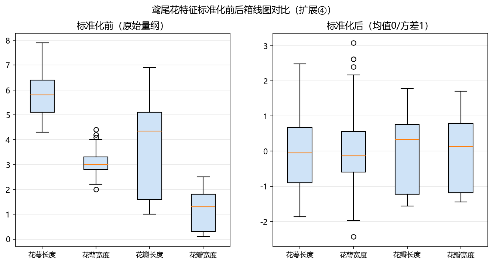

四维鸢尾花特征量纲差异明显（花萼长度 4~8 vs 花瓣宽度 0.1~2.5），
z-score 标准化后各维均值为 0、方差为 1，梯度下降条件数显著改善。
另完成 one-hot 编码、分层划分（测试集类别比例严格 1/3）、
MNIST [0,255]→[0,1] 归一化、±2 像素平移增强，详见 `outputs/exp4/`。

### 3.5 扩展⑤ 框架优化功能

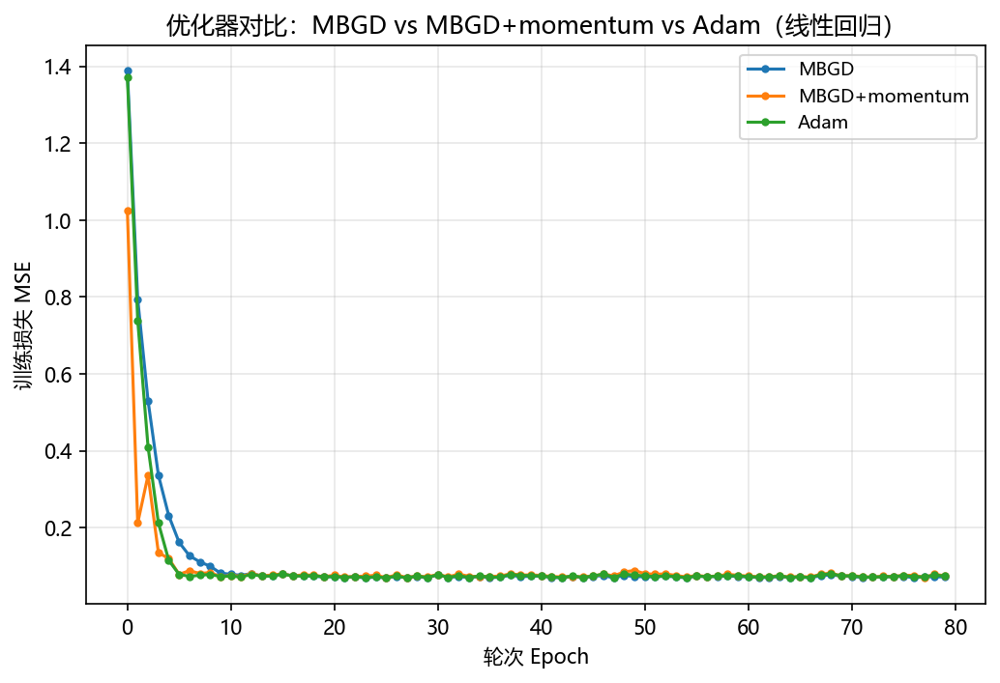

在三维线性回归上，MBGD / MBGD+momentum / Adam 均收敛到真实
`w=[1.5,-2.0,0.7]` 附近；加入动量后前期下降更快。其余功能：

- Dropout：训练态置零比例 0.503、保留位放大 2 倍，评估态恒等；
- 学习率调度：step 模式第 11 轮 lr 0.1→0.05；plateau 模式平台期后降到 9.8e-5；
- EarlyStopping：300 轮预算在第 45 轮停止（最优在第 37 轮）；
- 保存/加载：往返后预测 `max_diff = 0`。

---

## 四、应用任务结果

### 4.1 线性回归与逻辑回归

- 线性回归（y=3x+2+噪声）：MBGD 学到 w=2.9899、b=2.0444；Adam 学到 3.0204、2.0394，
  最终 MSE≈0.93（接近噪声方差 1.0）。
- 逻辑回归（两团高斯）：测试准确率 **100%**，决策边界
  `4.1002·x1 - 2.9606·x2 + 4.7009 = 0`。

### 4.2 鸢尾花

线性 Softmax 回归 77.78%，两层 MLP（4-16-3）**93.33%**，满足 ≥90% 要求；
MLP 的 ReLU 隐层能拟合非线性类间边界。

### 4.3 MNIST 手写数字（自研 CNN）

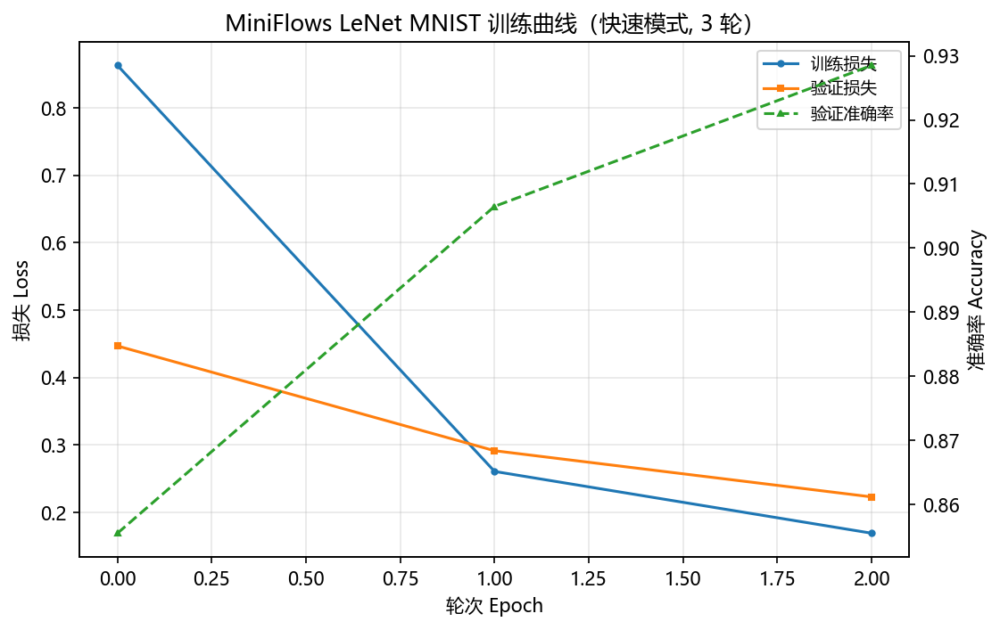

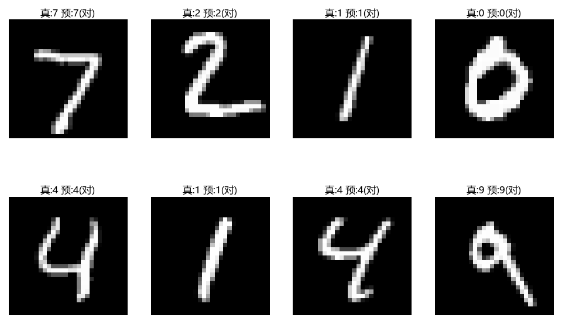

LeNet 风格网络（44,426 参数），8000/2000 类别均衡子集，3 轮 Adam lr=1e-3：
测试准确率 **92.85%**，总耗时 10.9 秒。预测示例中 8 张图全部正确。

### 4.4 与 PyTorch 对照

| 框架 | 测试准确率 | 参数量 | 训练耗时 |
|---|---|---|---|
| 自研 MiniFlows (numpy) | 92.85% | 44,426 | 10.9 s |
| PyTorch | 93.05% | 44,426 | 1.4 s |

两框架使用完全相同的网络结构、数据子集、超参与 CPU 设备。准确率差 0.20 个百分点，
说明自研卷积/反向传播/Adam 的实现正确；耗时差约 8 倍来自 numpy 解释器开销与
float64，符合预期（PyTorch 由 C++/MKL 后端执行）。

### 4.5 DonkeyCar 自动驾驶

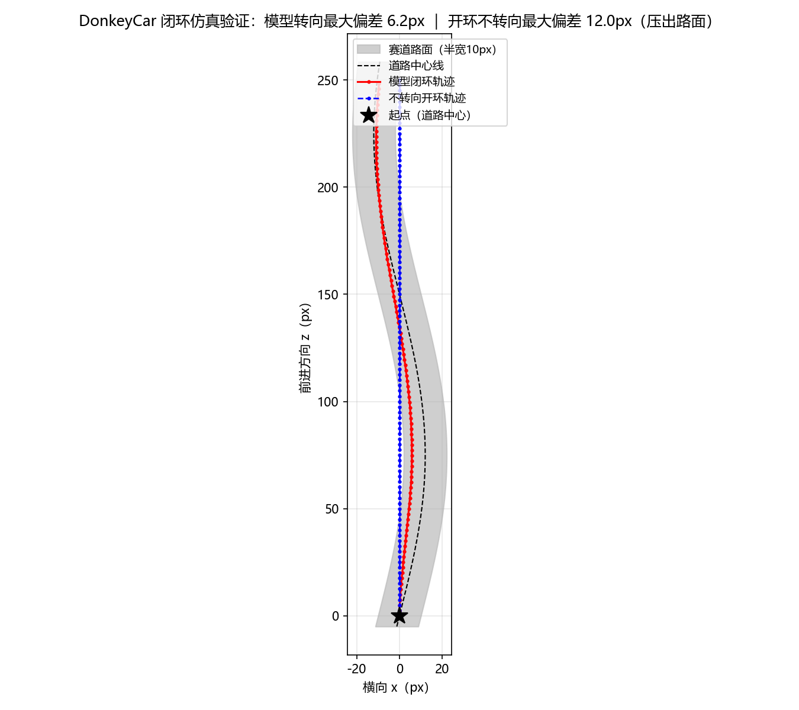

用 numpy 逐像素渲染合成赛道（深灰背景 + 浅灰路面），标签为由道路中心线倾斜
计算出的转向角。演示脚本中 CNN 回归模型（38,369 参数）8 轮训练后测试
**MAE=0.0446**，闭环最大横向偏差 6.24 px（半宽 10 px）。该演示把测试集同时
用作验证集，指标偏乐观，因此另外实现了严格评测脚本。

### 4.6 DonkeyCar 严格评测（5 种子 + 鲁棒性 + 多赛道闭环）

`applications/donkeycar_eval.py` 采用 900 条样本、**70%/15%/15%** 训练/验证/测试
划分；测试集全程不参与训练、早停或模型选择；重复 5 个随机种子：

| 测试 | 结果 |
|---|---|
| 留出测试集开环（675 条） | MAE **0.0534±0.0069**，RMSE 0.0695，P95 0.1369，R² 0.973 |
| 直行基线 | MAE 0.3575（模型相对下降 85.1%） |
| 同分布闭环（6 赛道×5 模型） | 成功率 **100%**，最大偏差均值 2.90 px |
| 分布外闭环（A=14~16、λ=220~250） | 成功率 **100%**，最大偏差均值 5.75 px |
| 极端闭环（A=18~22、λ=160~190、速度 3.0） | 成功率 **0%**，最大偏差均值 20.69 px |
| 噪声闭环（σ=0.05） | 成功率 **100%** |
| 不转向开环 | 成功率 **0%** |
| 保存/加载 | 预测最大差 0；单帧约 0.5 ms（≈约 2000 FPS，CPU） |

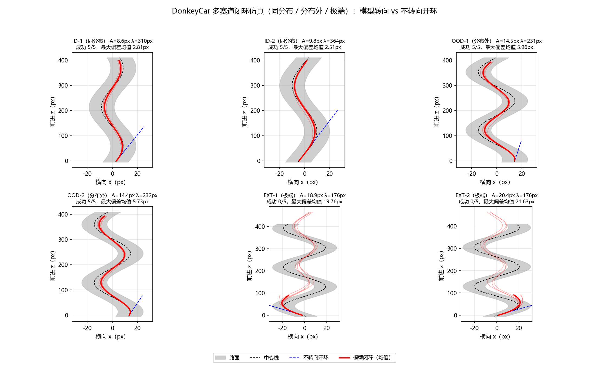

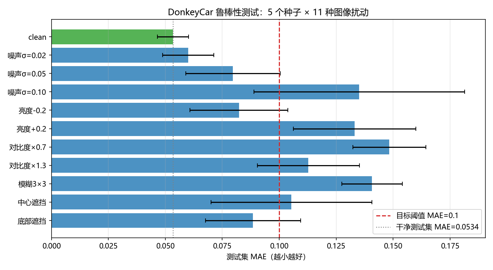

鲁棒性（开环 MAE）：干净 0.0534；噪声 σ=0.05 为 0.0797；亮度 +0.2 为 0.1331；
对比度×0.7 为 0.1484（最差）；模糊 3×3 为 0.1408；底部遮挡 0.0885。
说明模型对轻度噪声/遮挡可接受，但在强对比度变化和模糊下会明显退化。
完整表格与逐赛道结果见 `outputs/donkeycar/测试报告.md`。

---

## 五、测试与质量保证

| 测试 | 结果 |
|---|---|
| `tests/test_core.py` | 全部通过（算子形状、34 项数值梯度、MLP/CNN 训练、Dropout） |
| `tests/test_infra.py` | 9/9 通过（缩放、划分、DataLoader、早停、调度、存取） |
| 端到端任务 | 5 个应用全部达到预期指标 |
| DonkeyCar 严格评测 | 5 种子 MAE 0.0534±0.0069；同分布/分布外/噪声闭环 100%，极端 0% |
| 复现性 | 固定种子后结果可重复；保存/加载预测逐位一致 |

---

## 六、问题与解决记录

1. **numpy 反射运算被吸收**：`np.ones((2,2)) - node` 返回 object 数组。
   解决：`Node.__array_priority__ = 1000`，让 numpy 调用 `Node.__rsub__`。
2. **偏置广播语义不一致**：`(F,)` 偏置对 4D 输入应按通道维对齐。
   解决：`broadcast_add` 显式 reshape 为 `(1,F,1,1)`。
3. **内置函数被算子遮蔽**：`ops.py` 内 `max()` 遮蔽内置 `max`，导致 `mean` 反向报错。
   解决：改用条件表达式，并在注释中记录该陷阱。
4. **BCE/MSELoss 广播陷阱**：`(N,1)` 预测与 `(N,)` 标签被广播成 `(N,N)`，
   损失与梯度错误且不报错（DonkeyCar 严格评测时因此一度学不动）。解决：
   两个损失内部都显式把标签 reshape 为 `(N,1)`。
5. **计算图图片异常巨大**：图中只有 text/annotate，matplotlib 自动缩放失效，
   `bbox_inches='tight'` 把 1000×700 的图撑到 98645×30517。解决：显式 `set_xlim/ylim`。
6. **图像网格标题消失**：`ax.axis("off")` 会隐藏 xlabel。解决：改用 `set_title`。

---

## 七、结论

MiniFlows 以约 8,400 行（含详细中文注释）实现了深度学习框架的核心机制，
并通过 17 项数值梯度检验、5 个端到端任务和 PyTorch 同结构对照验证了正确性；
五项扩展全部完成，覆盖可视化、可验证性、可诊断性、数据工程与训练优化。
项目达到了课程"优秀"标准所要求的基础目标 + 三项以上改进 + 完整需求/设计/报告文档。
