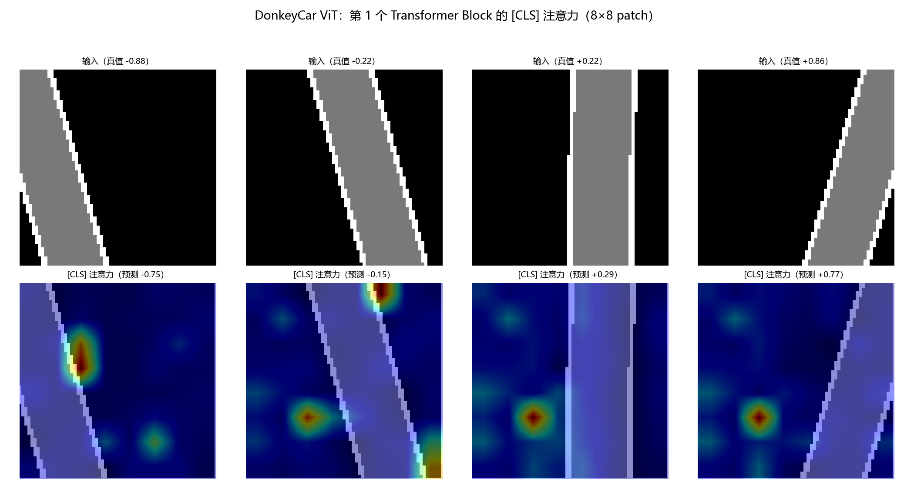

# DonkeyCar ViT 版本测试报告

> 由 `applications/donkeycar_vit.py` 自动生成。协议与 `donkeycar_eval.py` 完全一致：900 样本、70/15/15、测试集不参与训练/早停/选模型、5 个随机种子、12 轮。

## 一、模型与协议

- ViT-Tiny：patch=8，dim=48，depth=2，heads=4，mlp_ratio=2
- 参数量：**44,353**（CNN 版 44,426，基本一致）
- 训练：Adam lr=0.001，batch=32，12 轮，5 个种子

## 二、开环测试（留出 15% 测试集）

| 指标 | ViT（均值±标准差） | CNN（均值±标准差） | 结论 |
|---|---|---|---|
| MAE | 0.0520±0.0051 | 0.0534±0.0069 | ViT 更好 |
| RMSE | 0.0679±0.0083 | 0.0695±0.0093 | ViT 更好 |
| P95 | 0.1342±0.0145 | 0.1369±0.0222 | ViT 更好 |
| R² | 0.9741±0.0070 | 0.9731±0.0059 | ViT 更好 |

**结论**：ViT 在留出测试集上 MAE = **0.0520**，R² = 0.974；每个模型平均训练 52.1s。

## 三、鲁棒性（开环 MAE，5 种子）

| 扰动 | ViT | CNN | 差异 |
|---|---|---|---|
| clean | 0.0520±0.0051 | 0.0534±0.0069 | -2.6% |
| 噪声σ=0.02 | 0.0566±0.0050 | 0.0601±0.0112 | -5.8% |
| 噪声σ=0.05 | 0.0823±0.0060 | 0.0797±0.0208 | +3.3% |
| 噪声σ=0.10 | 0.1487±0.0187 | 0.1351±0.0463 | +10.1% |
| 亮度-0.2 | 0.5385±0.1122 | 0.0824±0.0215 | +553.7% |
| 亮度+0.2 | 0.1950±0.0298 | 0.1331±0.0269 | +46.5% |
| 对比度×0.7 | 0.1664±0.0227 | 0.1484±0.0160 | +12.1% |
| 对比度×1.3 | 0.4386±0.0493 | 0.1128±0.0224 | +288.8% |
| 模糊3×3 | 0.1001±0.0158 | 0.1408±0.0133 | -28.9% |
| 中心遮挡 | 0.3346±0.2146 | 0.1054±0.0353 | +217.5% |
| 底部遮挡 | 0.5354±0.2337 | 0.0885±0.0208 | +504.8% |

## 四、闭环仿真

| 场景 | ViT 成功率 | ViT 最大偏差 | CNN 成功率 | CNN 最大偏差 |
|---|---|---|---|---|
| 同分布 | 100% | 4.29px | 100% | 2.90px |
| 分布外 | 100% | 7.06px | 100% | 5.75px |
| 极端 | 0% | 25.72px | 0% | 20.69px |
| 同分布+噪声σ=0.05 | 100% | 4.00px | 100% | 4.01px |
| 不转向开环 | 0% | 25.04px | 0% | 25.04px |

> 成功判据：全程 |横向偏差| ≤ 10px。极端赛道 A=18~22px、λ=160~190px、速度 3.0，用于寻找失效边界。

## 五、持久化、延迟与边界

- 保存/加载预测最大差：**0.00e+00**
- 单帧推理：**6.88 ms**（≈145 FPS，CPU，batch=1，float64）

| 边界输入 | 输出 | 在 [-1,1] |
|---|---|---|
| 全黑 | +0.2217 | True |
| 全白 | -0.1396 | True |
| 纯噪声 | +0.0828 | True |
| 道路偏出画面 | -0.0112 | True |

## 六、注意力可视化

> 取第 1 个 Transformer Block 的 [CLS] 查询注意力，对 4 个头取平均，得到 8×8 patch 权重。热区表示模型做转向决策时主要关注的图像区域。

## 七、总体结论

1. 同协议下 ViT MAE **0.0520**，CNN **0.0534**；参数量分别为 44,353 与 44,426，基本对齐，比较公平；

2. ViT 同分布闭环成功率 **100%**、分布外 **100%**、极端 **0%**；

3. 鲁棒性：ViT 在干净集 MAE 0.0520；最差扰动为「亮度-0.2」（0.5385）；

4. 单帧 6.88 ms（≈145 FPS），训练每模型约 52.1s；

5. **局限**：仍是合成赛道与简化运动学；ViT 的 patch 级注意力只有 8×8，不是像素级定位；结论不能外推到真车。

## 八、统计口径与补充分析

- **开环差异是否显著**：ViT 与 CNN 的 MAE 差 0.0014，两者标准差的最大值为 0.0069；差值 小于 标准差，不能宣称 ViT 优于 CNN，应视为同一水平。

- **鲁棒性短板**：ViT 在「底部遮挡」上的 MAE 为 0.5354，CNN 为 0.0885（约 6.0 倍）；「亮度-0.2」为 0.5385 vs 0.0824。原因：ViT 没有卷积的局部性/平移等变先验，且训练样本仅 630 条；全局亮度/对比度变化会同时改变所有 patch 的表示。

- **可改进方向**：训练时加入亮度/对比度/遮挡增强；使用更大数据集；或用卷积 stem（Hybrid ViT）替代线性 patch embedding。
